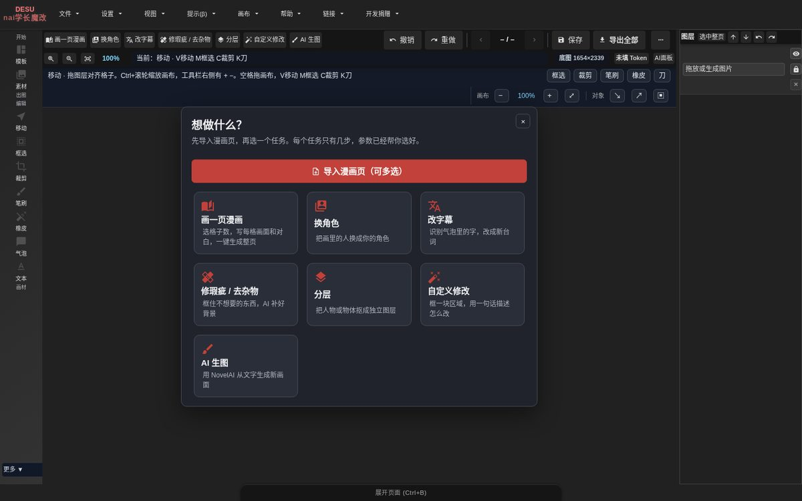

# Manga Editor Desu · NAI 版

**给新手的漫画修图 / 嵌字工具**：换角色、改对白、去杂物、拆图层、画一整页，大多数事情 2–4 次点击完成。
基于 [Manga Editor Desu](https://github.com/new-sankaku/manga-editor-desu) 的非官方 GPL-3.0 修改版。全部在你自己的电脑上运行，浏览器里使用。

[English](#english) · [5 分钟上手](docs/QUICK_START_BEGINNER.md) · [第三方声明](THIRD_PARTY_NOTICES.md) · [安全](SECURITY.md) · [参与开发](CONTRIBUTING.md)

## 能做什么

| 任务 | 怎么做 | 用到 |
|---|---|---|
| **换角色** | 自动找出页面上的人物 → 点一下要换的人 → 上传参考图 → 生成 → 应用。可把同一角色在其他格一起换（按脸部识别） | GPT 图像（你的 API） + 本机人物识别 |
| **改字幕** | 导入后自动识别本页文字 → 直接改台词 → 应用：原字自动擦掉、新字按气泡排版（中文避头尾） | 本机 OCR + 文字检测 + LaMa |
| **修瑕疵 / 去杂物** | 框一下 → 生成预览 → 对比原图 → 应用；接缝和色调自动对齐 | 本机 LaMa 或 GPT |
| **分层** | 点人物（智能点选，3 个候选）或「按格子拆成图层」 | 本机 SAM 2 / 自动找格子 |
| **画一页漫画** | 选 3/4 格或照本页格子 → 每格写一句画面和对白 → 一键生成整页 | GPT 图像 |
| **AI 生图** | NovelAI 文生图 / 图生图 | NovelAI（你的 Token） |
| 专业模式 | 上游完整编辑器：分镜、气泡、图层、网点、画笔、多页、导出 | — |

所有 AI 结果都放在**新图层**上，原图不动，Ctrl+Z 一步撤销。

| 换角色（左：原图，右：换成参考角色） | 一页完成稿 |
|---|---|
|  |  |

| 改字幕：每页的文字识别结果各自保存，切页即时出现 | 按格子拆成图层：点一格可以取消 |
|---|---|
|  |  |

## 安装与启动

需要：**Python 3.10+**（[下载](https://www.python.org/downloads/)）和一个现代浏览器（Chrome / Edge / Firefox）。不需要 Node。

1. 下载：GitHub 页面 **Code → Download ZIP** 后解压（放在路径短的文件夹，例如 `D:\MangaEditor`），或 `git clone`。
2. 启动：

| 系统 | 启动编辑器 | 可选：安装本机 AI 功能（OCR、去字、换角色识别、智能点选，仅 CPU，约 1.5 GB） |
|---|---|---|
| **Windows 10/11** | 双击 `一键启动.bat` | 双击 `安装AI功能.bat`，再按提示 `winget install UB-Mannheim.TesseractOCR` |
| **macOS** | 终端里 `./start.sh` | `bash scripts/install-ai.sh`，再 `brew install tesseract tesseract-lang` |
| **Linux** | `./start.sh` | `bash scripts/install-ai.sh`，再 `sudo apt install tesseract-ocr tesseract-ocr-jpn tesseract-ocr-jpn-vert tesseract-ocr-chi-sim` |

浏览器会自动打开 `http://127.0.0.1:8000/index.html`。关掉启动窗口（或 Ctrl+C）即停止。

3. 第一次用到某个 AI 功能时，编辑器会说明要下载哪个模型、多大、什么许可证，**你确认后才下载**（校验 SHA-256，存在用户目录 `~/.cache/manga-editor/`，Windows 为 `%USERPROFILE%\.cache\manga-editor\`；LaMa 和 manga-ocr 用 PyTorch / Hugging Face 自己的缓存目录）。
4. 用 GPT 或 NovelAI 的功能：点右上角 `⋯` → **服务设置**，填你的 API 地址 / Key 或 NovelAI Token，点「测试连接」（见下一节）。

### 服务设置：所有地址和 Key 只在这一个地方

| 服务 | 填什么 | 测试连接 |
|---|---|---|
| GPT 图像（换角色、修瑕疵、自定义、画一页） | 服务：**OpenAI 官方** 或 **自定义**（任意 OpenAI Images 兼容服务，填以 `/v1` 结尾的地址）；API Key；模型 | 只读模型列表、不生成、不花钱；测试后模型下拉框换成该服务实际列出的图像模型 |
| NovelAI（AI 生图） | 访问令牌 Token（高级里可改 API 地址/本地代理） | 只读订阅信息，不花 Anlas |
| AI 导演（可选） | 任意 OpenAI 兼容聊天服务的地址、模型、Key | 发一次极短的测试请求 |
| 导入漫画打标签（可选） | 本机 Tagger 地址 | 发一张 8×8 白图 |
| 本机文字识别 / 去字、本机抠图 | 不需要 Key | 检查本机服务状态 |

- **没有内置中转站**：默认只有 OpenAI 官方地址。用别的兼容服务时自己填地址；`gpt-image-2.5` 只在该服务的模型列表里有时才会被推荐。
- 所有值只保存在这台电脑（浏览器本地存储；可取消「本机记住 Key」只保留到关闭页面）。
- 想用 `.env` 里的 `GPT_IMAGE_API_KEY` 而不在页面填 Key 时：本机服务只会把这个 Key 发给**服务设置里保存的那个地址**（保存时登记在 `user_data/services.json`；内网 / IP / 非 HTTPS / 带端口的地址会被拒绝，不跟随重定向）。
- 没设置就点「换角色」「画一页」「自定义修改」时，会直接打开服务设置并提示要填什么；「修瑕疵」可用本机 LaMa，不需要 Key。

> Windows 支持目前只经过代码审查和 GitHub Actions 的 `windows-latest` 离线测试，**尚未在真实 Windows 电脑上完整验证**，详见 [docs/WINDOWS_READINESS.md](docs/WINDOWS_READINESS.md)。遇到问题欢迎反馈。

## 上手

看 **[docs/QUICK_START_BEGINNER.md](docs/QUICK_START_BEGINNER.md)**（5 分钟）。简单说：打开 → 导入漫画页 → 点首页上的任务 → 按卡片上的 1、2、3 做。想要全部参数时打开「高级」，或切换到「专业模式」。

## 已知限制

- **换角色在复杂多人画格里不稳定**：GPT 偶尔会改到同格的另一个人，或把头身比例画得不自然。务必先看「对比原图」再应用；不满意可以把范围框大一点重试。
- **自动找格子需要白色格间留白**：无边框、出血满版或黑底分格识别不出来，此时用手动框选。
- **本机 AI 只用 CPU**：人物识别首次 20–60 秒，智能点选几秒，LaMa 去字数秒；空闲 10 分钟后自动释放内存。低内存电脑（<8 GB）可能偏慢。
- GPT 生成质量取决于你使用的模型和服务；默认只有 OpenAI 官方的 `gpt-image-1`，测试连接后可从服务列出的模型里选。
- 提示词助手的示例缩略图不随仓库提供，第一次打开时点「下载示例图」（上游图约 30 MB、NovelAI 素材图约 137 MB，均校验 SHA-256）；不下载也能正常用提示词。
- 文字识别以日文漫画为主（Tesseract + 可选 manga-ocr）；手写体、艺术字、拟声词识别率较低（「保留拟声词」默认开启）。

## 隐私与安全

- 服务只在本机 `127.0.0.1` 上运行，所有本机接口检查来源（同源），其他网页无法调用。
- API Key / Token 只保存在你的浏览器本地存储或本机 `.env`，不会写进项目文件、日志或导出图片。
- 图片只发送到**你自己设置的** GPT / NovelAI 服务；本机 AI 功能完全离线。
- 不包含任何统计或跟踪代码。漏洞请按 [SECURITY.md](SECURITY.md) 私密报告。

## 常见问题

**双击 `index.html` 打不开？** 必须通过启动脚本运行（浏览器禁止 `file://` 下的大部分功能）。

**提示 8000 端口被占用？** 已经开着一个编辑器窗口时会直接打开浏览器；如果是别的程序占用，关掉它再启动。

**一定要 GPT / NovelAI 吗？** 不需要。编辑、嵌字、改字幕、去字、分层都可以完全离线；换角色、画一页、自定义修改需要 GPT 图像服务。

**模型很大，能放到别处吗？** 设置环境变量 `XDG_CACHE_HOME` 指向别的磁盘即可（模型会放在其下的 `manga-editor/`）；也可以把 `~/.cache/manga-editor/` 整个拷到另一台电脑。

**要显卡吗？** 不需要，全部 CPU 可用；有 NVIDIA 显卡也不会自动使用（为了安装简单）。

## 参与开发

见 [CONTRIBUTING.md](CONTRIBUTING.md)。提交前：`npm test`（含隐私守卫）、`npx eslint js --max-warnings 0`、新手 E2E（`node scripts/novice-task-e2e.cjs`，GPT 全部 mock）。

## 许可证

**GPL-3.0**（见 [LICENSE](LICENSE)），沿用上游。打包的库与字体、按需下载的模型及其许可证见 [THIRD_PARTY_NOTICES.md](THIRD_PARTY_NOTICES.md)。

---

## English

**A beginner-friendly manga editing and lettering tool**: swap a character, rewrite dialogue, remove objects, split into layers or draw a whole page, mostly in 2–4 clicks. Unofficial GPL-3.0 fork of [Manga Editor Desu](https://github.com/new-sankaku/manga-editor-desu). Runs entirely on your computer, used in the browser. The UI is Chinese-first, with English, Japanese, Korean, French, Russian, Spanish and German translations.

### Features
- **Character swap**: detects characters, click the one to replace, upload a reference, generate, compare, apply; optionally the same character in other panels (face matching). Needs a GPT image API.
- **Rewrite captions**: text is read automatically on import (per page), edit lines, apply: old text erased (comic-text-detector + LaMa), new text typeset in the bubble.
- **Fix / remove objects** with LaMa (local) or GPT, with automatic seam and tone matching.
- **Layers**: smart click-select (SAM 2.1 tiny, 3 candidates) or split the page by panels automatically.
- **Draw a page**: pick a layout (or reuse the current page's panels), one line per panel, generate.
- **NovelAI** text-to-image / image-to-image with your own token.
- Full upstream editor in **Pro mode**. Every AI result lands on a new layer; one Ctrl+Z undoes it.

### Install
Python 3.10+ and a modern browser. Download ZIP (or clone), then:
- **Windows**: double-click `一键启动.bat` (start) and optionally `安装AI功能.bat` (local AI, CPU) + `winget install UB-Mannheim.TesseractOCR`.
- **macOS / Linux**: `./start.sh`; optionally `bash scripts/install-ai.sh` + Tesseract from brew/apt.

The browser opens `http://127.0.0.1:8000/index.html`. Models are downloaded only after you confirm (size, license, SHA-256 shown). All endpoints and keys live in one place, **服务设置 (Service settings)** (`⋯` menu): GPT image service (preset *OpenAI official* or *custom* OpenAI-compatible base URL ending in `/v1`, key, model — after *Test connection* the model list comes from the service; `gpt-image-2.5` is suggested only if listed), NovelAI token, optional AI Director and local tagger, local OCR/LaMa/cutout status. Each has its own test button; nothing is stored outside this computer. There is **no built-in relay**. A server-side `GPT_IMAGE_API_KEY` from `.env` is only sent to the base URL saved in Service settings (private/IP/non-HTTPS URLs and redirects are refused). GPT tasks open Service settings with a hint when nothing is configured.
Windows is statically reviewed and CI-tested on `windows-latest` but **not yet verified on a real Windows PC**.

### Known limitations
Character swap is unstable in complex multi-person panels (always check the before/after compare); automatic panel detection needs white gutters; local AI is CPU-only (first character detection 20–60 s); OCR targets Japanese manga.

### Privacy
Local server on `127.0.0.1` with same-origin checks on every endpoint; keys stay in your browser storage or local `.env` and never enter project files, logs or exports; images go only to the services you configure; no analytics.

### License
GPL-3.0. Bundled libraries/fonts and on-demand models: see [THIRD_PARTY_NOTICES.md](THIRD_PARTY_NOTICES.md).
