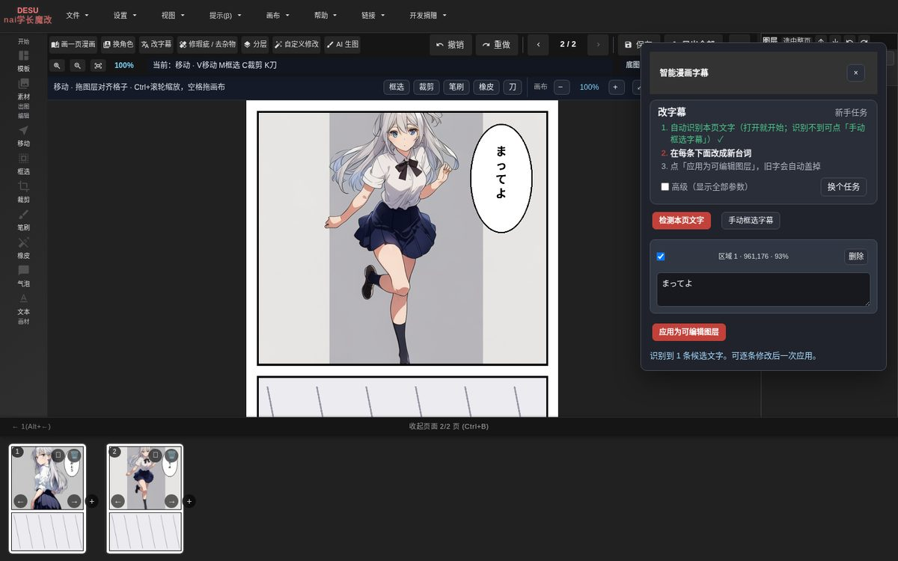

# Manga-NAI-GPT

**新手也能用的漫画修图 / 嵌字工具**：换角色、改字幕、去杂物、拆图层、画一整页，大多数事情点 2–4 下就完成。

**中文** · [English](README_EN.md) · [5 分钟上手](docs/QUICK_START_BEGINNER.md) · [文档](docs/README.md) · [更新记录](CHANGELOG.md)

Manga-NAI-GPT 是基于 [Manga Editor Desu](https://github.com/new-sankaku/manga-editor-desu) 的漫画编辑器，把常见工作做成「任务卡」：打开页面、点一个任务、按 1-2-3 做完。文字识别、去字、抠图、找格子都在**你自己的电脑上用 CPU 运行**；需要重画的部分（换角色、画一页）调用**你自己设置的** OpenAI 兼容图像服务，AI 生图用 NovelAI。所有结果都是新图层，原图不动，`Ctrl+Z` 一步撤销。

## 功能

| 任务 | 做什么 | 需要 |
|---|---|---|
| **换角色** | 自动找出人物 → 点要换的人 → 上传参考图 → 预览对比 → 应用；同一角色可在其他格一起换（脸部识别） | 图像服务 + 本机人物识别 |
| **改字幕** | 导入时自动识别本页文字 → 直接改台词 → 原字擦掉、新字按气泡排版（中文避头尾，可保留拟声词） | 本机（免费） |
| **修瑕疵 / 去杂物** | 框一下 → 预览 → 应用；接缝和色调自动对齐 | 本机 LaMa 或图像服务 |
| **分层** | 智能点选人物（3 个候选）或按格子一键拆成图层 | 本机（免费） |
| **画一页漫画** | 选格子数或照本页格子 → 每格写画面和对白 → 一键生成整页 | 图像服务 |
| **AI 生图** | NovelAI 文生图 / 图生图 | NovelAI Token |
| **专业模式** | 原版全部工具：分镜、气泡、网点、笔刷、多页、模拟器、导出 | — |

| 换角色（左原图 / 右结果） | 一页完成稿 |
|---|---|
|  |  |
| **改字幕**：每页识别结果自动缓存 | **分层**：按格子拆成图层 |
|  |  |

## 安装（3 步）

需要 **Python 3.10+** 和 Chrome / Edge / Firefox。不需要显卡。

| | Windows 10/11 | macOS | Linux |
|---|---|---|---|
| 1. 下载 | [Releases](https://github.com/h1neolzr7f/Manga-NAI-GPT/releases/latest) 下载源码 ZIP，解压到短路径（如 `D:\MangaNAI`） | 同左，或 `git clone` | 同左，或 `git clone` |
| 2. 启动 | 双击 **`一键启动.bat`** | 终端运行 `./start.sh` | 终端运行 `./start.sh` |
| 3. 本机 AI（可选） | 双击 **`安装AI功能.bat`**，再 `winget install UB-Mannheim.TesseractOCR` | `bash scripts/install-ai.sh` 和 `brew install tesseract tesseract-lang` | `bash scripts/install-ai.sh` 和 `sudo apt install tesseract-ocr tesseract-ocr-jpn tesseract-ocr-chi-sim` |

浏览器会自动打开 `http://127.0.0.1:8000/index.html`。启动窗口就是本机服务，关掉它即停止。本机模型在第一次用到时才下载（先告诉你大小和许可证，你确认后下载并校验 SHA-256）。

## 快速上手

1. 点首页「**导入漫画页**」（可多选）。
2. 点一个任务，比如「**改字幕**」，按卡片上的 1、2、3 做。
3. 满意就「应用」，不满意 `Ctrl+Z`。完成后「**导出全部**」得到每页 PNG + 项目文件。

详细步骤见 **[docs/QUICK_START_BEGINNER.md](docs/QUICK_START_BEGINNER.md)**。

## 服务设置（所有地址和 Key 只在这里）

右上角 `⋯` → **服务设置**。每项都有自己的「测试连接」，测试不花钱。

| 服务 | 填什么 |
|---|---|
| GPT 图像（换角色、修瑕疵、自定义、画一页） | 「OpenAI 官方」或「自定义」（任意 OpenAI Images 兼容服务，地址以 `/v1` 结尾）+ API Key；测试后从该服务列出的模型里选 |
| NovelAI（AI 生图） | 访问令牌 Token |
| AI 导演 / 导入打标签（可选） | 你自己的聊天模型服务 / 本机 Tagger 地址 |
| 本机文字识别、去字、抠图 | 不需要 Key，只显示状态 |

- **没有内置中转站**，图片只发给你自己设置的服务。
- Key / Token 只保存在这台电脑；`.env` 里的 Key 只会发给服务设置里保存的地址。
- 没设置就点需要 GPT 的任务时，会直接打开服务设置并提示缺什么。

## 已知限制

- **换角色在复杂多人画格里不稳定**：偶尔会改到同格另一个人或比例不自然，请先看「对比原图」再应用。
- **自动找格子需要白色格间留白**：无边框、满版出血、黑底分格要手动框选。
- **本机 AI 只用 CPU**：首次人物识别 20–60 秒，内存 < 8 GB 的电脑会偏慢。
- **Windows 尚未在真实电脑上完整验证**（只经过代码审查和 CI 的 `windows-latest` 离线测试），见 [docs/dev/WINDOWS_READINESS.md](docs/dev/WINDOWS_READINESS.md)。
- 文字识别以日文漫画为主；手写体、艺术字识别率较低。

## 常见问题

**双击 `index.html` 打不开？** 要用启动脚本打开（浏览器在 `file://` 下禁用大部分功能）。

**8000 端口被占用？** 已有编辑器在运行时会直接打开浏览器；若是别的程序占用，关掉它再启动。

**一定要 GPT / NovelAI 吗？** 不用。嵌字、改字幕、去字、分层、专业模式都可完全离线；只有换角色、画一页、自定义修改需要图像服务。

**要显卡吗？** 不需要。

**模型放哪？** `~/.cache/manga-editor/`（Windows：`%USERPROFILE%\.cache\manga-editor\`）；设置 `XDG_CACHE_HOME` 可换盘。

**提示词助手的缩略图是空的？** 打开提示词助手点「下载示例图」（逐张校验）；不下载也能正常用提示词。

## 隐私与安全

本机服务只监听 `127.0.0.1`，所有本机接口检查同源；不含统计或跟踪代码。漏洞请按 [SECURITY.md](SECURITY.md) 私下报告。

## 致谢

- 上游项目 **[Manga Editor Desu](https://github.com/new-sankaku/manga-editor-desu)**（new-sankaku）——编辑器本体来自这里，本项目是其非官方修改版，与上游无附属关系，问题请在本仓库提。
- 本机模型与库：comic-text-detector、LaMa、SAM 2、isnet-anime、manga-ocr、Tesseract、deepghs 动漫人脸 / CCIP 等，完整列表与许可证见 [THIRD_PARTY_NOTICES.md](THIRD_PARTY_NOTICES.md)。

## 参与开发

见 [CONTRIBUTING.md](CONTRIBUTING.md)；开发文档在 [docs/dev/](docs/dev/)。

## 许可证

[GPL-3.0](LICENSE)，与上游相同。
